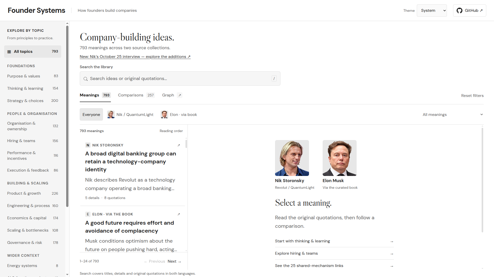

# Founder Systems

An interactive, source-backed research library for exploring how founders build and operate companies. Start with a topic, follow a meaning to its original quotations, and compare mechanisms without losing their context. The first collection brings together **Nik Storonsky / QuantumLight** and **Elon Musk as represented in Eric Jorgenson's The Book of Elon**.

[Open the interactive library](https://founder-systems.timsmykov.chatgpt.site/) · [Read the case study](docs/case-study.md) · [Explore the methodology](docs/methodology.md).

Explore **793 meanings, 3,822 detailed facets and 257 comparison groups**, including 25 same-mechanism groups. All **5,138 original quotation records** remain included; 4,499 are attached to meaning cards and the remainder preserves audit/context evidence. The project name accommodates future founders; the current interface/data model still targets this first pair.



## Project and authorship

**Created by Tim Smykov using AI-assisted research and development.** My work spans the research question, evidence structure, comparison model, interactive product and verification process. The founders, source authors and quoted speakers retain authorship of their ideas and words; the comparison and presentation are my editorial work.

The question behind the project is practical: how can you explore recurring company-building mechanisms without flattening different sources into a list of slogans? Meaning cards preserve conditions and detailed facets; comparison groups describe the relationship rather than assuming that similar wording implies the same mechanism.

Start with a topic or search, open a meaning card to inspect its quotations, then use the graph and comparison groups to explore related ideas. The public application runs entirely in the browser. This is an exploratory research product, not a validated theory of company performance or an endorsement of any founder's conduct.

Read the [product case study](docs/case-study.md) for the design decisions and evidence boundaries.

## Run locally

```sh
python3 -m http.server 8080
```

Open `http://localhost:8080`. No application server, database or API key is required. Light/dark/system themes, topic navigation, original-language search, quotations and a zoomable graph work in the browser. Phone layouts include bottom navigation, filter/topic sheets and a dedicated reader.

## Verify

```sh
python3 scripts/verify.py
```

Optional browser checks:

```sh
npm install
npx playwright install chromium
ATLAS_BASE_URL=http://localhost:8080/ npm run test:browser
```

The repository contains the selected quoted library and its interface with a new Git history. Full book/transcript source files, native worker packets and research execution history remain in a separate private research archive. `export-verification.json` and `release-manifest.json` bind the exported records to their source snapshot and file hashes.

## Read the evidence carefully

English statements and comparison labels are research interpretations; quotations retain their source language, speaker, locations and hashes. QuantumLight is institutional evidence. The book contains editorial and other attributed voices as well as Musk. ASR errors and source uncertainty remain relevant. A partial overlap is not an identical mechanism, and an unmatched meaning is not proof of uniqueness.

See [methodology](docs/methodology.md), [source-use notice](NOTICE.md) and [photograph credits](assets/portraits/LICENSES.md). Existing source licences apply to their respective material; public visibility is not a blanket licence over third-party sources. No endorsement by a founder or source organisation is implied.

## October 25 interview update

[Read the standalone analysis](docs/nik-senra-20261025.md). Forty interview-local meanings add ten canonical nodes and thirty source-bound extensions/reinforcements. The 130 additional details retain source-time variants; this is not a claim of 130 new unique principles. Eight additional comparisons and five existing-group supplements preserve review status. Original-English automatic captions were used, without full audio verification.
