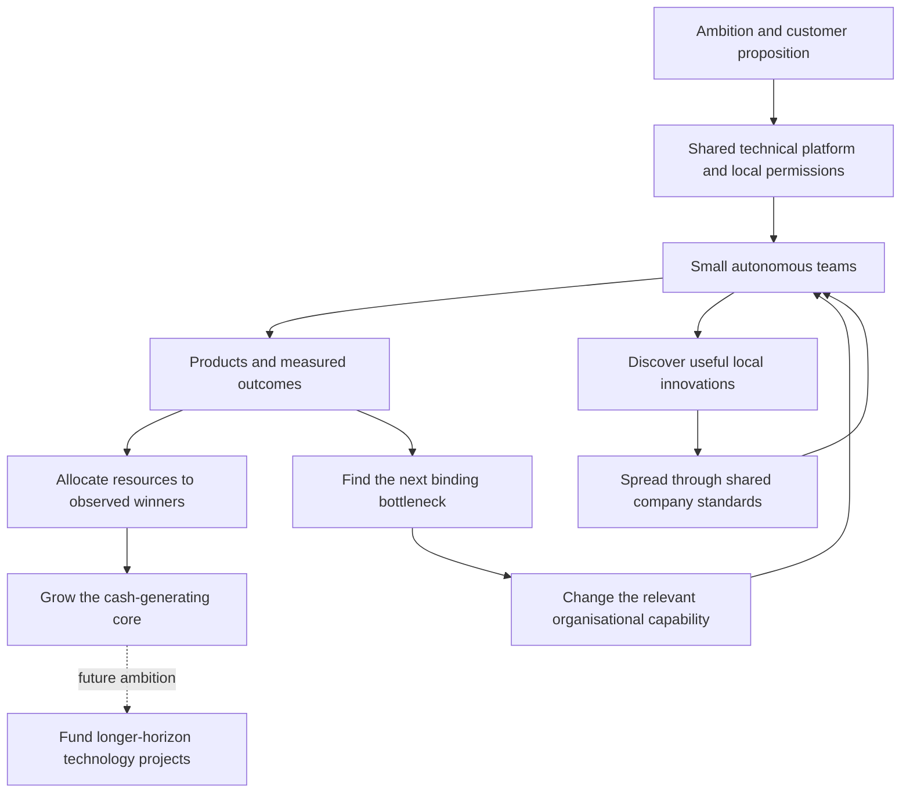

# Building a company that improves its own ability to build

This interview describes an operating system whose output is better products, delivered economically across more markets. Its most useful contribution is the connection between the parts: ambition shapes the target; technical architecture makes replication possible; people and metrics support distributed execution; bottleneck removal and the spread of working innovations improve the organisation itself; capital allocation determines what gets more resources.

This is an editorial reconstruction of Nik's account, not a formal system he names or an empirically validated management theory. The [interactive map](https://founder-systems.timsmykov.chatgpt.site/#q=David+Senra) retains the separate propositions, exact captions and qualifications.

## 1. The machine has an output and a changing constraint

The product is the output, not the organisation chart. At [17:20](https://www.youtube.com/watch?v=hT_MAAwFLIc&t=1040s), Nik moves from an abstract machine metaphor into a useful sequence: observe where progress slows, change the responsible part, and continue. A growing central team becomes independent teams sharing a platform; regulatory friction requires a new capability; recruiting throughput becomes the next constraint. These are different interventions, selected by the problem rather than a single preferred reorganisation.

The closest book connection is Musk's account of a production line being limited by its slowest element. Both prioritise a binding constraint. Banking organisational capabilities and factory throughput remain different domains. See **I010 / R001**.

## 2. Local autonomy needs a common operating foundation

The self-guided-person material is largely established in the existing corpus. What this interview adds more clearly is the complementary central role: ensure teams are synchronised and use common equipment, then spread a useful discovery beyond its originating team. At [25:23](https://www.youtube.com/watch?v=hT_MAAwFLIc&t=1523s), the broad reporting span is explained through low recurring management demand, not the disappearance of direction or standards.

This separates two management functions that can otherwise look contradictory. People can independently achieve their goals while the founder improves common tools and coordinates direction. Nik rejects managers who merely relay numbers, but still asks managers to change direction, introduce innovations and find easier execution paths. The interview does not say all management or coordination should be removed. See **I017–I022**.

The Musk autonomy comparison is strong at the level of self-directed capable people and aligned goals. The communication comparison is only partial: Nik describes his own direct access; Musk explicitly permits anyone to cross the reporting chain.

## 3. AI changes the design of the organisation, not only task speed

At [23:31](https://www.youtube.com/watch?v=hT_MAAwFLIc&t=1411s), Nik moves from a ten-person product-team heuristic to a proposal for two or three people when a developer can cover more functions. The causal claim is expanded capability per person, which changes which roles need to be separated. It is still a proposal, not demonstrated rollout results.

His AI-employee target is more specific than a chatbot: a participant in calls, email, Slack and internal systems. That is an integration specification. The interview does not supply the permission model, quality controls or performance evidence needed to implement it safely and reliably. See **I014–I016**.

The design example at [27:00](https://www.youtube.com/watch?v=hT_MAAwFLIc&t=1620s) makes the diffusion mechanism concrete: give an LLM the coded design system, prompt the flow, inspect a clickable interface, then spread the working method. The reported three-to-four-times speed improvement remains Nik's claim. This extends the earlier Figma-based founder-review account without deleting it. See **I018–I019**.

No close Musk-book equivalent was established for this particular AI-team design, AI-employee specification or coded-design-system workflow. General enthusiasm for AI is insufficient evidence of the same mechanism.

## 4. There are two investment horizons, which should not be collapsed

The current product-bet method at [20:28](https://www.youtube.com/watch?v=hT_MAAwFLIc&t=1228s) is largely reinforcement: fund small teams, launch, compare gross-profit trajectories with earlier cohorts, cut weak bets and give winners more teams. The new interview adds a dated account of cutoffs and examples; it does not resolve every older numerical variant. In particular, it does not precisely anchor the eighteen-month cutting window to approval or launch. See **I012–I013**.

At [61:00](https://www.youtube.com/watch?v=hT_MAAwFLIc&t=3660s), a different ambition appears: generate enough cash to fund technology projects that may produce no P&L for several years. Nik explicitly says many ideas are still in his head and resources/time are currently insufficient. This is not evidence that today's product-bet method has been replaced.

The specific financing connection to Musk is strong: the book describes Starlink commerce paying toward Mars and, separately, satellite launch revenue supporting a later human-transport ambition. The shared mechanism is a commercial base funding a more distant mission. Nik's proposed projects and Musk's attributed SpaceX account have different maturity and purpose. See **I036 / R008**.

## 5. Some constraints must be addressed before scale

The licensing lesson at [08:45](https://www.youtube.com/watch?v=hT_MAAwFLIc&t=525s) is not simply that regulation matters. The faster light-licence route can make the subsequent hard approval more difficult once many customers are exposed to the regulator's decision. Preserve this as an initial-sequencing lesson, separately from the earlier account of customer-migration permission after receiving a bank licence. See **I006**.

The sales example at [34:00](https://www.youtube.com/watch?v=hT_MAAwFLIc&t=2040s) has a similar sequencing shape: discover an economical repeatable selling method, then add people. Expensive leadership and a large team should not substitute for proving the method. This partially overlaps with Musk's advice to work out product bugs at small scale, but the actual gates differ: sales economics versus technology and production quality. See **I023 / R007**.

## 6. Marketing is a resource-allocation and trust problem

Nik's shift from organic growth to paid marketing is not a timeless reversal from good to bad. His account introduces a different stage and need. First, recruit expertise from an environment with large marketing budgets and little room for error. Then understand LTV and payback. For a digital bank with little physical presence, consider trust and the price of physical exposure as well as digital impressions.

At [57:00](https://www.youtube.com/watch?v=hT_MAAwFLIc&t=3420s), airports and the Barcelona experience store become examples of comparing channel costs. The interesting new mechanism is this comparison, not merely advertising more. The source does not show that the impressions are equally effective or report incremental conversion. His claim concerns advertising in airports, not buying the airport assets. See **I034–I035**.

The historical Musk-book account of avoiding advertising and improving the product instead belongs beside this as a different method, not a forced match. Nik's earlier organic phase remains relevant context. See **R013**.

## 7. Do not turn rhetoric, anecdotes or forecasts into validated rules

The interview contains sharp claims about investors, professional CEOs, age and working hours. Retain their meaning, but keep their status visible. The coworking survival story is not a representative causal study. Model features involving investor-partner age are not independent hiring criteria. Reported fund IRR, support automation and engineering-speed figures are not verified performance measurements.

There is a substantive tension on work intensity: Nik recommends weekend work as necessary for survival; the cited Musk passage explicitly reserves hundred-hour weeks for emergencies. These are not identical measures of work, but the qualification matters. See **I025 / R012**.

Finally, Pragma is described as an existing transaction-trained foundation model, while broader model/data-centre ambitions remain prospective. Neither a product name nor a large transaction count establishes the claimed model's performance. The captions also contain damaged numerical and negative phrases, preserved in the source and flagged rather than silently repaired. See **I037** and each card's qualifications.

## Interview-local meanings and their canonical destinations

### NS25:I001: Choose competition with an intention to win

[Read this idea and its quotations](https://founder-systems.timsmykov.chatgpt.site/#m=G%3Afounder_context-02%3AI015). reinforcement.

Nik describes a longstanding competitive disposition: choosing a game means wanting to be number one.

- He connects competitiveness to childhood sports and olympiads.
- He suggests character and inherited disposition, without establishing a causal account.

Qualification: Personal self-description; no genetic or psychological inference about employees.

### NS25:I002: Use fragmented national markets as the opportunity for a global bank

[Read this idea and its quotations](https://founder-systems.timsmykov.chatgpt.site/#m=G%3Astrategy_growth-01%3AI015). extension.

Nik wants to build the leading bank in at least 100 countries, offering better products at better prices and saving customer time.

- He reports roughly 38 live countries and an expansion pace of 10–15 markets every one to two years; these are interview-time statements.
- The dinner metaphor extends ambition beyond retail into enterprise and potentially investment banking.
- He identifies manual work and high costs as opportunities for cheaper investment-banking services.
- The offer includes financial services plus non-financial services such as stays and eSIMs.

Qualification: Ambition, footprint and expansion expectations are distinct. The early caption says 2 years ago; do not infer a founding date from it.

### NS25:I003: Compete against your own current operating standard

[Read this idea and its quotations](https://founder-systems.timsmykov.chatgpt.site/#m=G%3Afounder_context-02%3AI028). reinforcement.

Nik focuses on how he would outperform his own business and giving near-full daily effort, rather than controlling competitors.

- Ask how to outcompete or outsmart the current version of the business.
- Giving full daily effort makes losing less attributable to avoidable personal under-effort.
- The Shopify corporate-raider analogy belongs to Senra, not Nik.

Qualification: Not a guarantee of winning and not an instruction to stop market research.

### NS25:I004: Short executive horizons can favour defence over transformation

[Read this idea and its quotations](https://founder-systems.timsmykov.chatgpt.site/#m=G%3Astrategy_growth-01%3AI038). reinforcement.

Nik argues that professional executives protecting jobs and bonuses can avoid bold product and industry moves that a founder is willing to attempt.

- He names a three-to-four-year executive horizon.
- Protecting personal employment can diverge from improving the organisation.
- He describes combining necessary defence with offensive product and industry expansion.

Qualification: Nik generalises about professional CEOs; the interview does not establish that every non-founder behaves this way.

### NS25:I005: Founder identification with the company is his argument for risk alignment

[Read this idea and its quotations](https://founder-systems.timsmykov.chatgpt.site/#m=G%3Astrategy_growth-01%3AI038). extension.

Nik says he treats his interests and the company as one, and argues to regulators that his desire for company survival discourages excessive risks.

- His stated objective is what benefits the company rather than a separate personal career.
- He invokes survival alignment when challenging regulators’ interpretation of growth as excessive risk.

Qualification: Self-reported alignment is not evidence that his actual decisions are safer or that regulatory controls are unnecessary.

### NS25:I006: Obtain the harder licence before customer scale magnifies approval risk

[Read this idea and its quotations](https://founder-systems.timsmykov.chatgpt.site/#m=G%3Anik-senra-20261025%3AI006). new_mechanism.

The faster initial e-money route can create a later licensing bottleneck: Nik says a regulator faces greater consequences when approving a bank with millions of existing customers.

- He contrasts roughly one year for the lighter licence with three or four years for a banking licence at the original decision point.
- Applying with seven or eight million UK customers makes potential supervisory failure much more consequential.
- He recalls almost five years to obtain the UK bank licence.
- This is distinct from the earlier corpus account about permission to migrate customers after the licence was granted.

Qualification: Do not conflate e-money regulation with being unregulated. Timelines are recollections, not independently verified dates.

### NS25:I007: Bank status supports primary-account trust beyond early adopters

[Read this idea and its quotations](https://founder-systems.timsmykov.chatgpt.site/#m=G%3Acapital_risk_regulation-02%3AI016). extension.

Nik treats banking status as a trust requirement for customers to place salaries, wealth and broader financial activity with a provider.

- He contrasts niche early adopters with the ambition for 40–80% population penetration.
- He cites Chime and Cash App as his examples of non-bank limitations.
- He reports about 80% adult penetration in Ireland and lower shares elsewhere.

Qualification: His critique and penetration figures are attributed claims, not verified market shares or a universal growth ceiling for non-banks.

### NS25:I008: Weak incumbents and local conditions affect penetration

[Read this idea and its quotations](https://founder-systems.timsmykov.chatgpt.site/#m=G%3Astrategy_growth-02%3AI011). extension.

Nik attributes Ireland’s high penetration to weak banking competition, a small market and many people with links outside Ireland.

- He describes penetration as gradual rather than an instant campaign result.
- The Ireland example combines competition, size and cross-border population links; it does not isolate one causal factor.

Qualification: Country comparisons are interview-time judgments.

### NS25:I009: Technical ignorance and blame avoidance can lock in legacy systems

[Read this idea and its quotations](https://founder-systems.timsmykov.chatgpt.site/#m=G%3Astrategy_growth-01%3AI037). extension.

Nik links refusal to migrate a core banking system to migration risk, job protection and leaders lacking the technical ability to execute the change.

- A legacy third-party core may need replacement even when migration introduces real operational risk.
- Without technical skills, doing nothing becomes the default.
- He says banking requires building technology as well as handling regulation.

Qualification: This is his account of incumbent behaviour, not a recommendation to ignore migration or customer risk.

### NS25:I010: Rebuild the company around the next binding bottleneck

[Read this idea and its quotations](https://founder-systems.timsmykov.chatgpt.site/#m=G%3Anik-senra-20261025%3AI010). new_mechanism.

Nik describes an iterative operating loop: observe the company producing the desired product, identify the constraint, change the responsible organisational capability, and repeat.

- Inputs include structure, people, product-building choices, technology, regulation and compliance; the output is a product people use.
- When growing a single team slowed delivery, he moved to small independent teams on one platform.
- Regulatory/compliance bottlenecks prompted regulatory and government-affairs capability.
- Recruiting throughput then required processes for finding good people fast.

Qualification: The caption paralyzed is inconsistent with the surrounding increase-in-speed explanation; do not quote it as a literal causal explanation or silently repair it.

### NS25:I011: Make delivery visible through metrics instead of political narratives

[Read this idea and its quotations](https://founder-systems.timsmykov.chatgpt.site/#m=G%3Aperformance-01%3AI017). reinforcement.

Nik says quantitative goals and transparent KPIs make it possible to challenge what individuals and managers achieved and reduce organisational politics.

- He links the habit to trading and risk management.
- Review whether the goal was reached and why it was missed.
- He contrasts visible outcomes with intuition and internal narratives.

Qualification: Metrics do not automatically establish causality, fairness or absence of gaming; the claim that they kill politics is Nik’s wording.

### NS25:I012: Separate product experiments into small funded teams

[Read this idea and its quotations](https://founder-systems.timsmykov.chatgpt.site/#m=G%3Aorganisation_execution-01%3AI018). extension.

A product idea can originate top-down or bottom-up, pass discussion, receive funding and a small cross-functional team, and then be built before performance is judged.

- He names front-end, back-end, product owner, designer and sometimes data-science/operations roles.
- A roughly ten-person team is a rule of thumb, with complexity-based exceptions.
- He describes a nine-to-eighteen-month product-building window.
- Fast shipping alone was insufficient; he introduced discipline because the performance of many launches was not tracked.

Qualification: Do not turn approximate team size into a universal hard cap.

### NS25:I013: Allocate product capital using historical gross-profit cohorts

[Read this idea and its quotations](https://founder-systems.timsmykov.chatgpt.site/#m=G%3Aorganisation_execution-01%3AI020). extension.

Nik compares launched bets with previous product outcomes, sunsets the weakest cohort and adds teams to the strongest rather than relying on his own intuition.

- He cites about fifty historical bets and the gross-profit growth of leading bets as the comparison base.
- The bottom 25% are sunset; the later exchange names up to the top 25% for scaling.
- Winning teams can become several teams, a department and a significant P&L line.
- The leading-bet 10–20% monthly growth and one/two/three-million GP sequence are illustrative; currency and consistent measurement windows are not fully specified.
- The eighteen-month cutting statement is not explicitly anchored to approval versus launch; do not invent that start date.

Qualification: Preserve earlier cutoff variants rather than overwriting them. The middle cohort’s policy is not explained here.

### NS25:I014: Redesign team boundaries when AI broadens an individual’s capability

[Read this idea and its quotations](https://founder-systems.timsmykov.chatgpt.site/#m=G%3Anik-senra-20261025%3AI014). new_mechanism.

Nik proposes reducing a typical product team from around ten people to two or three because one AI-assisted developer can span front-end, back-end and data science.

- He distinguishes ten years of optimising around human strengths and weaknesses from the structure AI may make possible.
- The proposed change follows capability breadth rather than simply applying a headcount reduction to unchanged roles.
- He says he is trying to change the structure; it is not reported as a completed company-wide rollout.

Qualification: A proposal, not validated staffing guidance or proof that all engineering functions can be combined.

### NS25:I015: Track separate AI changes in support, engineering and commercial operations

[Read this idea and its quotations](https://founder-systems.timsmykov.chatgpt.site/#m=G%3Aorganisation_execution-01%3AI027). extension.

Nik reports extensive support automation, faster engineering, and LLM use in translation and cross-selling, while saying adoption is still at an early stage.

- He says about 90% of the customer-support team is automated, and contrasts former staffing above 5,000 with a smaller present team.
- He reports a 30% engineering-speed increase without defining its measurement.
- Translation and cross-selling are additional LLM applications.

Qualification: The support denominator is ambiguous: do not convert it into 90% headcount reduction or 90% of tickets. These figures are not independently verified.

### NS25:I016: Define an AI employee through participation in the actual work environment

[Read this idea and its quotations](https://founder-systems.timsmykov.chatgpt.site/#m=G%3Anik-senra-20261025%3AI016). new_mechanism.

Nik’s stated target is an AI employee that joins calls, has email and Slack, accesses internal systems and performs work, beyond a prompt-and-response chat interface.

- He calls this a full-stack AI employee and believes it feasible with current technology.
- Access to internal back-office systems is part of the proposed capability.
- He presents widespread company adoption as an expectation, not an achieved deployment.

Qualification: No access-control, reliability, supervision or production-evaluation design is provided; do not infer autonomous permissions from the analogy.

### NS25:I017: Use direct access to contributors alongside a broad reporting span

[Read this idea and its quotations](https://founder-systems.timsmykov.chatgpt.site/#m=G%3Aorganisation_execution-01%3AI023). extension.

Nik reports roughly fifty to fifty-two direct reports and says he also works directly with designers, product owners and developers on relevant projects.

- His reporting span is enabled by capable self-guided people rather than frequent task-level supervision.
- Direction and synchronisation remain necessary even for autonomous contributors.

Qualification: Fifty reports is an observed configuration, not a universally appropriate span.

### NS25:I018: Spread demonstrated local innovations through common company standards

[Read this idea and its quotations](https://founder-systems.timsmykov.chatgpt.site/#m=G%3Anik-senra-20261025%3AI018). new_mechanism.

Nik treats identifying a useful innovation in one team and rapidly standardising it across departments as a core part of his role.

- Autonomous teams should use common tools rather than independently reinventing them.
- A new tool that increases speed should be made available through the shared standard.
- He reiterates that a local improvement should spread quickly.
- Senra’s Ford/Carnegie account is contextual analogy; it is not evidence about their methods independently checked here.

Qualification: The interview supplies no formal experiment threshold, rollout governance or exception policy.

### NS25:I019: Generate interactive designs from the coded design system

[Read this idea and its quotations](https://founder-systems.timsmykov.chatgpt.site/#m=G%3Anik-senra-20261025%3AI019). new_mechanism.

Nik describes a team giving its code-level design system to an LLM and prompting product flows, yielding clickable interfaces rather than only Figma frames.

- The output can run on a laptop or simulator and respond to clicks.
- Nik reports three-to-four-times faster design generation than producing Figma screens.
- He says he is pushing the workflow to all designers.

Qualification: The speed claim lacks an independent benchmark. Interactive design is not proof of secure, accessible or production-ready implementation.

### NS25:I020: Require managers to change outcomes rather than relay reports

[Read this idea and its quotations](https://founder-systems.timsmykov.chatgpt.site/#m=G%3Aorganisation_execution-01%3AI009). extension.

Nik challenges managers who only pass contributor information upward without improving direction, introducing innovation or finding an easier route to the roadmap.

- Relaying numbers alone does not explain managerial value in his account.
- The alternative contribution is changing direction or making execution more effective.

Qualification: This does not show that every coordinating or information-management role is unnecessary.

### NS25:I021: Evaluate autonomy through goals achieved per unit of management attention

[Read this idea and its quotations](https://founder-systems.timsmykov.chatgpt.site/#m=G%3Afounder_context-02%3AI025). reinforcement.

Nik distinguishes people who identify and achieve goals, people who need only a goal, people who need repeated guidance, and people who still fail with help.

- Exceptional people choose goals and achieve them themselves.
- Good people need a target but no repeated iteration.
- Average people need weekly direction; below-average people may miss despite the same support.
- Less management time per report enables a wider reporting span.

Qualification: This is Nik’s selection heuristic, not a complete performance rubric or evidence that onboarding/coaching has no value.

### NS25:I022: Evaluate executive success by results rather than being liked

[Read this idea and its quotations](https://founder-systems.timsmykov.chatgpt.site/#m=G%3Ahiring-01%3AI006). extension.

Nik says executives should make difficult performance decisions and reach goals with few resources; being liked can coexist with effectiveness but is not the objective.

- He says he removes average performers as well as below-average performers.
- He places winning ahead of interpersonal empathy in the specific decision context.
- He qualifies that tough executives may still be liked.
- Senra introduces an Elon anecdote; the comparison must use independently located book evidence rather than promote that anecdote to a direct Musk quotation.

Qualification: Retain this interview position alongside, not as a replacement for, QuantumLight’s formal performance categories and development/PIP policies.

### NS25:I023: Prove inexpensive sales economics before multiplying sales headcount

[Read this idea and its quotations](https://founder-systems.timsmykov.chatgpt.site/#m=G%3Anik-senra-20261025%3AI023). new_mechanism.

Using a B2B company at roughly one million ARR as an example, Nik argues for building a cheap repeatable selling system before hiring an expensive sales leadership hierarchy.

- The counterexample is an expensive VP of Sales who adds roughly fifty salespeople.
- First establish how to sell cheaply and achieve good payback.
- Then add people into the functioning system.

Qualification: The ARR and staffing numbers are illustrative. No universal threshold, payback target or claim that sales leadership is never needed is supplied.

### NS25:I024: Resource constraints can develop capability needed when capital disappears

[Read this idea and its quotations](https://founder-systems.timsmykov.chatgpt.site/#m=G%3Aorganisation_execution-01%3AI017). extension.

Nik argues that solving problems by thinking rather than spending develops entrepreneurial capability and prepares a business for less abundant financing.

- He criticises raising at high valuations and treating capital as effectively free.
- He distinguishes waste reduction from learning to solve the underlying problem.
- He still acknowledges strong US talent, universities and the broader ecosystem.

Qualification: His regional comparisons are opinions, not a causal evaluation of entire ecosystems.

### NS25:I025: Preserve work-intensity claims as personal observations and recommendations

[Read this idea and its quotations](https://founder-systems.timsmykov.chatgpt.site/#m=G%3Afounder_context-02%3AI010). extension.

Nik advocates weekend work and reports very long hours for himself and most direct reports, using survival in a former coworking cohort as his anecdote.

- He recalls 140 coworking companies, three survivors after five years and two after ten, with the survivors working weekends.
- He invokes China’s 996 and technical education as competitive context.
- He reports weaker alignment further down the hierarchy.

Qualification: The cohort anecdote does not establish causality or a representative survival statistic. The caption China is not competitive conflicts with surrounding context and is not repaired into a claim.

### NS25:I026: Difficult unit economics can force transferable operating improvements

[Read this idea and its quotations](https://founder-systems.timsmykov.chatgpt.site/#m=G%3Astrategy_growth-01%3AI024). extension.

Nik attributes learning to optimise many business problems to Europe’s constrained revenue opportunities, local requirements and difficult scaling environment.

- He recalls several years of negative gross margin followed by improvement to around 80% positive gross margin.
- Examples include capped interchange, credit constraints, local branches/accounts, languages and hiring constraints.
- He contrasts these constraints with opportunities he perceives in the US, Brazil and Mexico.

Qualification: The 20 basis points versus 100% caption is damaged and must not become a financial fact. Regulatory statements are attributed descriptions, not checked legal guidance.

### NS25:I027: Separate financial capital from operational decision rights

[Read this idea and its quotations](https://founder-systems.timsmykov.chatgpt.site/#m=G%3Afounder_context-01%3AI041). extension.

Nik advises founders to scrutinise shareholder terms and resist giving financial investors power to direct a business they have not operated.

- He names liquidation preferences, board seats and reduced founder voting rights as early concessions.
- He argues that observing boards does not itself teach operating a company.
- He wants investors to remain financial participants without votes or operational decision seats.
- Claims that LP fundraising is easy or investors never risk their own money are his rhetoric, not established general facts.

Qualification: No legal template or absolute governance rule is inferred. Some negations in automatic captions are damaged; the surrounding explicit advice governs the bounded interpretation.

### NS25:I028: Compare career trajectory with peers rather than trusting a senior CV

[Read this idea and its quotations](https://founder-systems.timsmykov.chatgpt.site/#m=G%3Aorganisation_execution-01%3AI004). extension.

Nik explains failed executive hires through changed capabilities/priorities and selection among available executives; he prefers unusually fast achievement trajectories.

- He recalls hiring more than fifty experienced executives in the early years and retaining only two; the timing around within one year is not fully clear.
- Past achievement need not transfer to a changed company, market or personal motivation.
- He says he tries to attract people at ages 25–30 with unusually strong peer-relative progression.
- He argues that many exceptionally successful older candidates have already left the hiring market.

Qualification: An attributed heuristic, not a validated age screen. Earlier Nik material explicitly allows experienced people who have built things.

### NS25:I029: Use financing rounds to replace investor board seats with operators

[Read this idea and its quotations](https://founder-systems.timsmykov.chatgpt.site/#m=G%3Aorganisation_execution-01%3AI032). extension.

Nik says he defended a valued intense employee against investor pressure and progressively removed VCs from the board, preferring people who have built businesses.

- He says one investor pressed him to dismiss his best person for being too hardcore; he refused.
- He describes investors backing down after conflict.
- Each investment round was an opportunity to reduce VC board involvement.

Qualification: No identities, actual shareholder documents or current board list were verified. Senra’s Kalanick anecdote is not Nik’s own evidence.

### NS25:I030: Use statistical startup selection to challenge conventional venture judgment

[Read this idea and its quotations](https://founder-systems.timsmykov.chatgpt.site/#m=G%3Acapital_risk_regulation-01%3AI041). extension.

Nik describes founding QuantumLight after a control-rights conflict and choosing models over subjective startup selection.

- He places the idea in 2022 or 2023 and associates it with an investor’s ability to block shareholder-agreement changes.
- He describes a separate company, run by someone else, not a Revolut internal fund.
- His aspiration is a large private-markets business analogous in scale to BlackRock, not a claim of having achieved that scale.

Qualification: Model validity, causal superiority and investor-conflict facts are not independently tested.

### NS25:I031: Combine investment capital with playbooks and a commercial route

[Read this idea and its quotations](https://founder-systems.timsmykov.chatgpt.site/#m=G%3Acapital_risk_regulation-01%3AI044). reinforcement.

QuantumLight’s proposed value includes practical operating manuals, Nik’s advice, and potential access to Revolut as a buyer or distribution channel.

- He names hiring, performance management and product expansion as playbook areas.
- Revolut buying a supplier’s product may provide a reference for sales to other enterprises.
- Potential distribution to Revolut customers is another route.

Qualification: An offered route is not proof that every portfolio company receives procurement or distribution.

### NS25:I032: Construct a diversified equal-sized venture portfolio and retain dated return claims

[Read this idea and its quotations](https://founder-systems.timsmykov.chatgpt.site/#m=G%3Acapital_risk_regulation-02%3AI005). extension.

Nik describes models selecting thirty to forty companies over two to three years, with equal initial investment amounts.

- He describes a fully invested $250m Series B fund and a $500m second fund focused on Series C.
- He claims about 56% IRR and a top-5% fund position; realised/unrealised and net/gross definitions are not supplied.
- He describes putting in 20% or 25% personally, other founders supplying remaining initial capital, and more institutional LPs in the second fund.
- A later-stage fund is a possible next step.

Qualification: Performance and capital figures are unverified source-time claims; no return guarantee or portfolio recommendation.

### NS25:I033: Evaluate investor track records at partner level and preserve feature caveats

[Read this idea and its quotations](https://founder-systems.timsmykov.chatgpt.site/#m=G%3Acapital_risk_regulation-01%3AI042). extension.

Nik says QuantumLight models inspect the specific investing partner as well as the fund, and describes partner age as one feature among many.

- He claims better cohorts for partners aged 30–40 and expresses a preference against partners above forty.
- He explicitly says age is not the only variable.
- He compares this with executive career peaks, but supplies no dataset, model specification or causal test.

Qualification: A reported model correlation is neither a causal finding nor a standalone hiring rule; do not transfer it into the performance skills.

### NS25:I034: Compare physical and digital impression costs while addressing trust

[Read this idea and its quotations](https://founder-systems.timsmykov.chatgpt.site/#m=G%3Anik-senra-20261025%3AI034). new_mechanism.

Nik explains airport advertising and experience stores as buying physical impressions at favourable economics while making a digital bank visible and trusted.

- Estimate travel or pedestrian frequency, impressions generated and placement cost, and compare with digital spend.
- He describes advertisements in roughly half of European airports, not ownership of the airports themselves.
- A Barcelona experience store is a product demonstration and visibility venue, not a traditional branch.
- Physical presence addresses perceived trust as well as acquisition economics.

Qualification: Equal counts of impressions do not establish equal attention, conversion, incrementality or trust. No measured ROI comparison is provided.

### NS25:I035: Source marketing expertise where large budgets meet little room for error

[Read this idea and its quotations](https://founder-systems.timsmykov.chatgpt.site/#m=G%3Ahiring-01%3AI004). extension.

To build a disciplined marketing operation, Nik looked to gaming companies whose large spending and narrow error tolerance demand skilled practitioners.

- Identify the companies with substantial spend and strong pressure to allocate it well.
- Recruit a capable operator from that environment; he says a first hire failed and a subsequent one worked.
- The operating focus includes LTV and payback, beyond simply spending more.

Qualification: Largest budgets alone do not prove practitioner quality; the low-error-tolerance condition is part of his reasoning.

### NS25:I036: Use a cash-generating core to finance longer-horizon technology bets

[Read this idea and its quotations](https://founder-systems.timsmykov.chatgpt.site/#m=G%3Anik-senra-20261025%3AI036). new_mechanism.

Nik wants a large banking cash-flow base that can fund capital-intensive technology projects even when they may not generate P&L for several years.

- He mentions deeper model development and own data centres as possible uses of substantial capital.
- The ventures may lie outside financial services; much of banking work is improving and integrating existing products.
- He says many ideas remain in his head because resources and time are not yet sufficient, with a tentative three-to-five-year hope.
- The two/three/four/five-year P&L exchange describes a long horizon, not a precise funding commitment.

Qualification: This is a future ambition. Do not apply the current product portfolio’s eighteen-month cutoff to these moonshots or claim it was formally repealed.

### NS25:I037: Reuse transaction representation learning across financial tasks

[Read this idea and its quotations](https://founder-systems.timsmykov.chatgpt.site/#m=G%3Anik-senra-20261025%3AI037). new_mechanism.

Nik reports a foundation model named Pragma trained on transaction data, describing a transformer operating over transactions rather than words.

- He reports approximately thirty million transactions daily and billions in the training-data context.
- He names anti-fraud, credit and potentially investment uses.
- The reported existing transactional model is separate from future ambitions for deeper models and owned data centres.

Qualification: No architecture specification, training dataset, evaluation, deployment scope or task-performance evidence is provided.

### NS25:I038: Differentiate global customer continuity and a broader revenue mix

[Read this idea and its quotations](https://founder-systems.timsmykov.chatgpt.site/#m=G%3Astrategy_growth-01%3AI008). extension.

Nik positions Revolut around global accounts, assets and transfers for internationally exposed customers, contrasting this with a locally focused bank offer.

- His pitch includes local and global products in one relationship, international account access and instant transfers.
- He describes subscriptions, transactions and commissions as more central than credit.
- Credit cards and loans are described as a small part of the balance sheet, not a nonexistent business.

Qualification: A future US customer proposition does not establish present eligibility or universal country availability.

### NS25:I039: Replicate both one ledger and accumulated operating knowledge across countries

[Read this idea and its quotations](https://founder-systems.timsmykov.chatgpt.site/#m=G%3Astrategy_growth-01%3AI001). extension.

Nik links one configurable cross-country system with lower maintenance headcount, better information access and reuse of product/marketing knowledge.

- He contrasts organic configuration with acquiring disconnected banks and extracting reports across systems.
- Country-specific onboarding can change through configuration rather than a complete rebuild.
- Maintaining one system needs fewer people than maintaining many banks’ systems, in his account.
- Product and marketing know-how can also be reused in each new country.

Qualification: This does not eliminate country-specific regulation, localisation, operational work or maintenance.

### NS25:I040: Preserve the transition from organic growth and travel dependence

[Read this idea and its quotations](https://founder-systems.timsmykov.chatgpt.site/#m=G%3Astrategy_growth-01%3AI035). extension.

Nik recalls an early organic-growth phase, a large pandemic revenue shock tied to travel, and optimisation before building a more deliberate paid marketing operation.

- He describes roughly six or seven initial years without marketing spending because time and resources were limited.
- The early card/e-money business was closely linked to travel, which fell during COVID.
- He reports about a 70% revenue decline and subsequent optimisation.

Qualification: The 2021/COVID and company-age wording is not reconciled into a verified timeline. Preserve earlier accounts as separate source variants.

